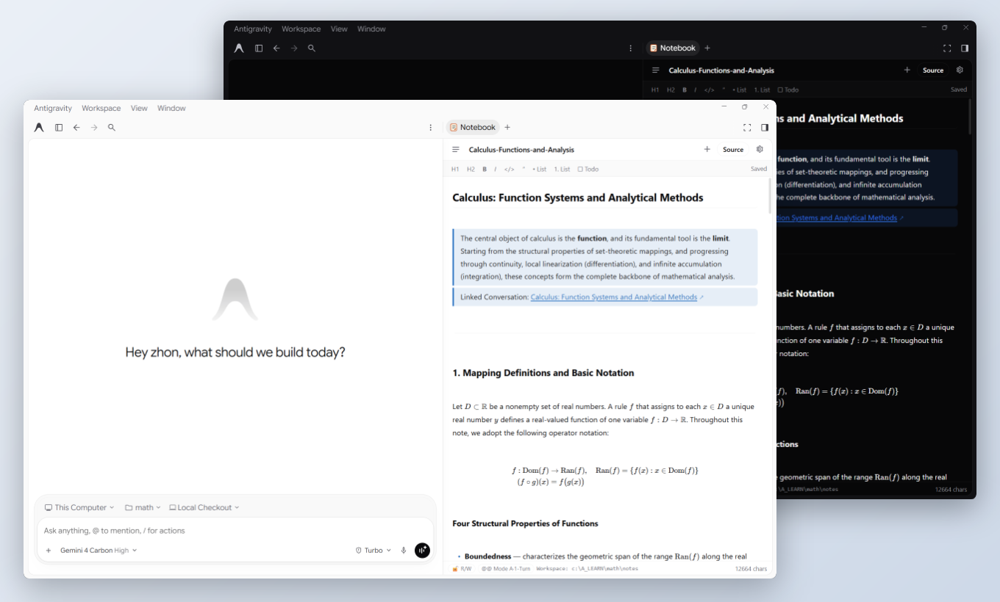
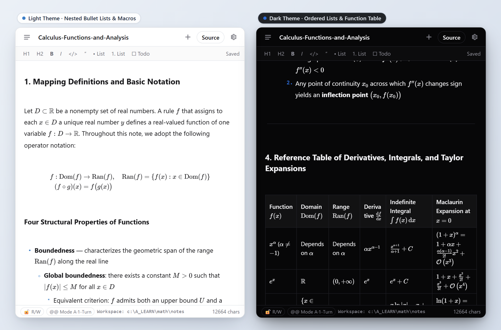
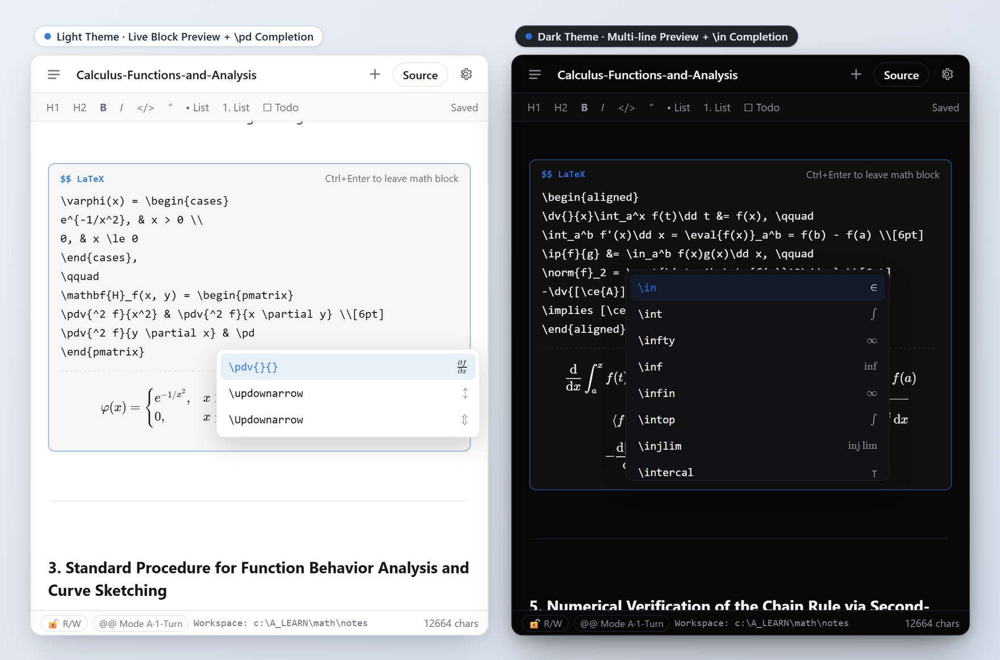
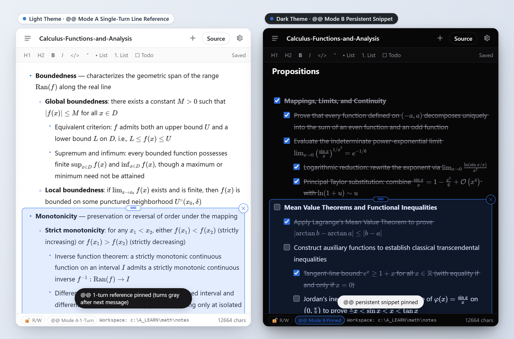
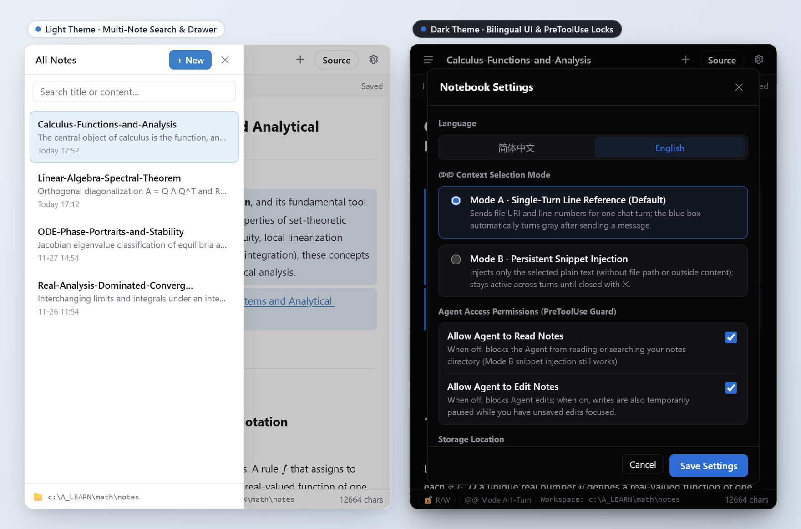

# Notebook (`notebook-antigravity-plugin`)

<p>
  <a href="https://antigravity.google"></a>
  <a href="https://github.com/Consyllus/notebook-antigravity-plugin/blob/main/LICENSE"></a>
</p>

English | [简体中文](./README.zh-CN.md)

A minimalist, **click-to-edit** local notebook sitting in the right-hand sidebar of **Google Antigravity** (Antigravity 2.0, IDE, and CLI / `agy`) — built so **you and the AI can co-edit the same note live**, **type `||` to drop clickable links to your chats and organize sessions**, **type `@@` to highlight just the lines you want the AI to read**, and **autocomplete LaTeX formulas as you type**, with plain local files you own forever and can move anywhere, plus automatic Light, Dark, and sub-theme matching.

<p align="center">
  
</p>

## Quick Install

### Antigravity One-Line Install (Recommended)

```bash
agy plugin install https://github.com/Consyllus/notebook-antigravity-plugin
```

> Once installed, ask *"Open the notebook"* or type `/notebook` in chat to open the right-hand side pane.

---

## Key Features

- **Click-to-Edit Notes, Live AI Co-Writing & `||` Chat Organizer**:
  - **Edit Right Where You Read**: Unlike read-only viewers, click any line in the notebook to edit it on the spot (`Ctrl+E` switches to plain text). Your own typing and the AI's edits share the same local note and stay in sync automatically.
  - **Type `||` to Link & Organize Chats**: Type `||` anywhere in a note to insert a clickable link to your current chat window. One click jumps right back to that conversation — making it easy to index, group, and revisit long-running chats from a single note (local file links open with one click too).

  > 💡 **Tip**: Prefer keeping your notes private or read-only? You can **separately toggle AI Read and Write permissions** on or off anytime in Settings.

  <p align="center">
    
  </p>

- **Offline LaTeX Syntax Autocomplete & Smooth Typing**:
  - **Type `\` for Instant Local Autocomplete**: Built-in local command catalog with zero AI wait — type `\` inside a formula to immediately pop up 950+ commands with live symbol previews, press `Tab` or `Enter` to fill in the command with your cursor placed inside the braces, and press `Tab` again to hop to the next blank (plus live preview below multi-line formulas while you edit, and copy-as-LaTeX when selecting math).
  - **No Input-Method Juggling**: In Chinese input mode, typing `￥￥` automatically turns into `$$` with your cursor right in the middle, and `、` inside formulas turns into `\` without switching keyboard layouts.

  <p align="center">
    
  </p>

- **Type `@@` to Share Specific Lines with the AI (Two Modes)**: Type `@@` on any line and drag the blue frame upward to pick the exact lines the AI should see:
  - **Mode B · Keep Across Chats**: Select once and keep that snippet active **across your current chat and any new or switched chats** — no copy-pasting needed (the AI only sees the lines inside the box, never the rest of your note; it won't re-send unchanged text in the same chat, updates automatically when you edit those lines, and stays on until you click `✕`).
  - **Mode A · One Message Only (Default)**: Points the AI to those lines for your very next message only, then turns gray automatically once sent.

  <p align="center">
    
  </p>

- **AI Read/Write Switches & Typing Protection**:
  - Separate switches let you turn **Allow AI to Read Notes** and **Allow AI to Edit Notes** on or off anytime.
  - **No Overwrite While You Type**: Whenever your cursor is inside the notebook with unsaved typing, AI edits pause automatically so the two of you never overwrite each other, and resume as soon as you save or click away.
- **Permanent Local Files, Zero Lock-In & Multi-Note Management**:
  - **Saved on Disk & Easy to Move Anywhere**: Every note is saved straight to your computer as a standard `.md` file — no cloud account required and no proprietary database lock-in. Closing the app or reinstalling never loses your notes, and you can back them up, copy the folder to another machine, or keep writing in any software that supports `.md` files anytime.
  - **Multiple Notes & Flexible Folder**: Create, search, switch, rename, and delete notes with automatic saving — stored in your project's `notes` folder by default, or in any fixed local folder you choose in Settings.

  <p align="center">
    
  </p>

- **Matches Light, Dark & Sub-Themes + Bilingual UI**: Backgrounds, borders, scrollbars, and math formulas automatically match Antigravity's **Light theme, Dark theme, and all sub-themes** in real time, with one-click switching between English and Simplified Chinese.

## Handy Shortcuts

| Type / Press | What It Does |
| :--- | :--- |
| `@@` | Pull up a selection box and drag upward to pick lines for the AI to read |
| `||` | Insert a clickable link to the current chat window (great for organizing sessions) |
| `\` + letters (in math) | Open the LaTeX formula autocomplete menu (`Tab` / `Enter` to fill in, `Tab` to hop braces) |
| `￥￥` (Chinese input) | Turn into `$$` automatically with the cursor placed in the middle |
| `Ctrl+E` / `Cmd+E` | Switch between Live View and Plain Text mode |
| `Ctrl+S` / `Cmd+S` | Save the current note right away |
| `Ctrl+N` / `Cmd+N` | Create a new note |

## Alternative Installation

### Manual Clone (Antigravity App / IDE)

**Windows (PowerShell)**
```powershell
git clone https://github.com/Consyllus/notebook-antigravity-plugin.git "$HOME\.gemini\config\plugins\md-notes"
```

**macOS / Linux**
```bash
git clone https://github.com/Consyllus/notebook-antigravity-plugin.git ~/.gemini/config/plugins/md-notes
```

> For workspace-only installation, clone into `.agents/plugins/md-notes` inside your project root.

## Credits & License

- **Organization**: [Consyllus](https://consyllus.com)
- **Author**: FalsenJing
- **License**: [MIT](./LICENSE)
