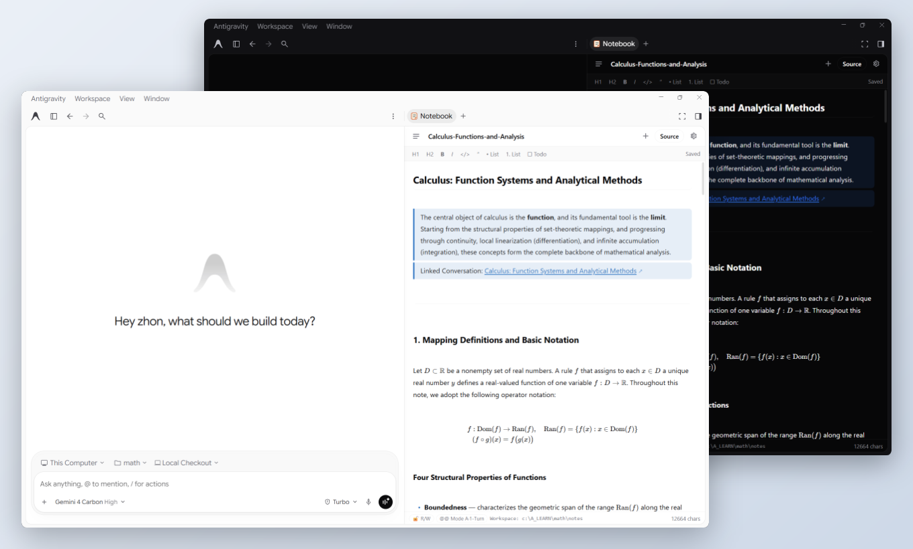
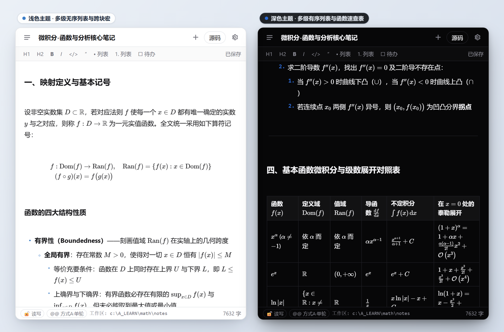
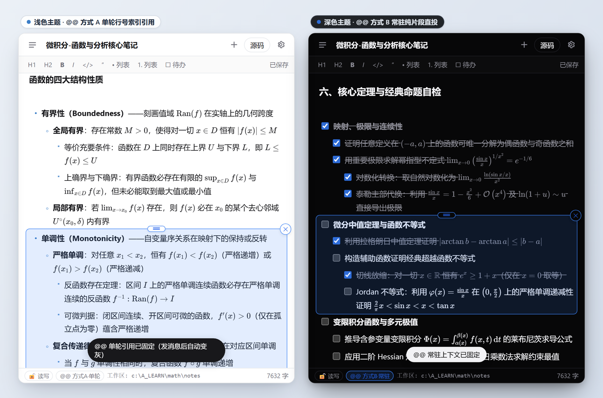

# 笔记本 (`notebook-antigravity-plugin`)

<p>
  <a href="https://antigravity.google"></a>
  <a href="https://github.com/Consyllus/notebook-antigravity-plugin/blob/main/LICENSE"></a>
</p>

[English](./README.md) | 简体中文

一个运行在 **Google Antigravity**（Antigravity 2.0、IDE、CLI / `agy`）右侧辅助面板中的**实时可编辑**本地笔记本插件——主打**所见即所得双向协同编辑**、**`@@` 跨对话持久上下文引用**，并**原生适配宿主的白色、黑色主题及全部对应子主题**。

<p align="center">
  
</p>

## 快速安装

### Antigravity 一键安装（推荐）

```bash
agy plugin install https://github.com/Consyllus/notebook-antigravity-plugin
```

> 安装完成后，在对话中输入「打开笔记本」或调用 `/notebook` 即可唤起右侧笔记本面板。

---

## 核心特性

- **原地直接可编辑与人机双向协同（`Ctrl+E`）**：不同于只读预览器，面板中的每一处内容均**可直接点击原地修改**——涵盖 `H1`–`H4` 标题、**多级无序 / 有序 / 待办列表**（`• / ◦ / ▪` 层级符号轮换与自动重排编号）、表格、代码块与引用块，支持工具栏快捷排版与 `Ctrl+E` 源码模式一键切换；用户手写编辑与 Agent 读写同一份本地 `.md` 笔记实时双向热同步，并支持 `conversation://` 对话跳转与 `file://` 本地文件直达。

  <p align="center">
    
  </p>

- **LaTeX 数学公式与 `0 ms` 语法自动补全**：
  - **离线完整版 KaTeX 渲染**：支持行内 `$...$` 与居中块级 `$$...$$` 公式（编辑块级源码时下方同步实时预览），内置 `mhchem` 化学方程式（`\ce{...}`）、常用 `physics` 微分/向量算符、整篇笔记跨块 `\gdef` 自定义宏，以及 `copy-tex` 选中公式复制出原始 LaTeX 源码。
  - **全量语法自动补全与中文输入优化**：在公式内输入 `\` 即刻弹出 **950+ 个官方命令与数学环境**候选框（附实时符号渲染预览），按 `Tab` / `Enter` 一键补全并落位至 `{}` 括号内部、连续按 `Tab` 依次跳空；支持中文输入法下连按 `￥￥` 自动替换为英文 `$$` 且光标居中。

  <p align="center">
    
  </p>

- **跨对话持久引用（`@@` 上下文框选双模式）**：在任意行输入 `@@` 呼出向上拖拽选框，精准控制向 Agent 暴露的笔记内容，支持跨会话常驻复用：
  - **方式 B · 跨对话持久片段引用**：框选一次即可在**当前多轮对话及后续新建/切换的任意对话中持久生效**，无需反复重新框选或粘贴（仅注入选中片段纯文本，不暴露文件其余内容与路径；内置会话级 `SHA-1` 哈希去重，同一对话内零重复消耗 Token，修改框选正文后自动增量更新，直至点击 `✕` 取消固定）。
  - **方式 A · 单轮文档索引引用（默认）**：向 Agent 发送单轮文件 URI 与起止行号索引（`#L起-止`），发送一轮消息后选框自动变灰失效。

  <p align="center">
    
  </p>

- **Agent 访问权限锁（`PreToolUse` 引擎级拦截）**：
  - 独立开关控制「允许 Agent 读取笔记」与「允许 Agent 修改笔记」。
  - **防编辑冲突动态写锁**：当用户光标正聚焦在笔记本内且有未保存修改时，自动临时拦截 Agent 写入，移开焦点或保存后自动放行。
- **多笔记管理与灵活存储**：
  - 支持新建、全文搜索、切换、内联重命名与删除多个笔记文件，实时自动保存。
  - 默认跟随 `<当前工作区>/notes` 目录，也可在设置面板指定任意本地自定义文件夹（内置目录浏览器）。

  <p align="center">
    
  </p>

- **适配宿主白色、黑色主题及对应子主题 + 中英双语切换**：底层全面接入 Antigravity 宿主语义色彩变量（`--background`、`--card`、`--foreground`、`--primary`、`--border`），界面背景、卡片层级、边框、滚动条、选中高亮与数学公式配色均实时同步宿主的**白色（浅色）主题、黑色（深色）主题及其全部对应子主题配色**，并支持简体中文与 English 即时切换。

## 常用快捷键

| 快捷键 / 触发词 | 功能说明 |
| :--- | :--- |
| `@@` | 在当前块生成上下文选框，向上拖拽框选范围 |
| `\` + 字母（公式内） | 呼出 `0 ms` LaTeX 命令与环境自动补全弹窗（`Tab` / `Enter` 补全并依次跳出 `{}` 括号） |
| `￥￥`（中文输入法） | 自动转换为英文 `$$` 并将光标置于中间 |
| `Tab` / `Shift+Tab` | 在无序、有序、待办列表项中缩进 / 退回层级 |
| `Enter` / `Backspace` | 延续当前列表层级；在空子列表项按回车或行首退格逐级退回 |
| `Ctrl+S` / `Cmd+S` | 立即保存当前笔记 |
| `Ctrl+E` / `Cmd+E` | 切换「实时预览」与「Markdown 源码」模式 |
| `Ctrl+B` / `Cmd+B` | 加粗选中文本 |
| `Ctrl+N` / `Cmd+N` | 新建笔记 |

## 其它安装方式

### 手动克隆至全局插件目录（Antigravity App / IDE）

**Windows (PowerShell)**
```powershell
git clone https://github.com/Consyllus/notebook-antigravity-plugin.git "$HOME\.gemini\config\plugins\md-notes"
```

**macOS / Linux**
```bash
git clone https://github.com/Consyllus/notebook-antigravity-plugin.git ~/.gemini/config/plugins/md-notes
```

> 若只需在单个项目内启用，也可克隆至项目根目录下的 `.agents/plugins/md-notes`。

## 关于与版权

- **Organization**: [Consyllus](https://consyllus.com)
- **Author**: FalsenJing
- **License**: [MIT](./LICENSE)
