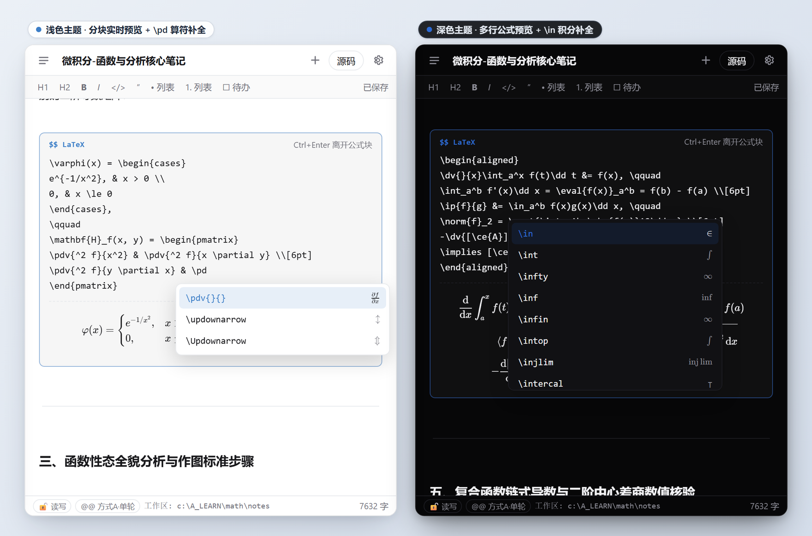
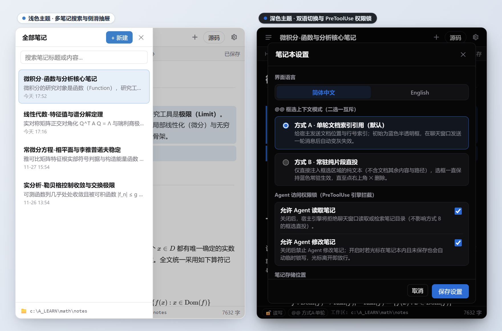

# 笔记本 (`notebook-antigravity-plugin`)

<p>
  <a href="https://antigravity.google"></a>
  <a href="https://github.com/Consyllus/notebook-antigravity-plugin/blob/main/LICENSE"></a>
</p>

[English](./README.md) | 简体中文

一个放在 **Google Antigravity**（Antigravity 2.0、IDE、CLI / `agy`）右侧栏里的**本地笔记本插件**——点开就能直接改字，支持**你和 AI 实时共写同一篇笔记**、**输入 `||` 插入聊天跳转链接来整理会话**、**输入 `@@` 框选笔记片段喂给 AI**、**写 LaTeX 公式自动弹出补全**；所有笔记均作为普通本地文件永久保存、随时可复制到其它工具或设备无缝迁移，并自动跟随软件的浅色、深色及全部子主题配色。

<p align="center">
  
</p>

## 快速安装

### Antigravity 一键安装（推荐）

```bash
agy plugin install https://github.com/Consyllus/notebook-antigravity-plugin
```

> 安装完成后，在对话中输入「打开笔记本」或调用 `/notebook` 即可唤起右侧笔记本面板。

---

## 核心特性

- **直接点击改字、与 AI 共写笔记、用 `||` 管理对话**：
  - **边看边改，和 AI 实时同步**：不像普通预览器只能看不能改，这里的文字点一下就能直接改（按 `Ctrl+E` 也能切回纯文本模式）；你自己手写和让 AI 帮你整理的，始终是同一份本地笔记，两边改完立刻同步。
  - **输入 `||` 插入聊天跳转链接，方便管理会话**：在笔记任意位置输入 `||`，就会自动把当前聊天窗口做成一个可点击的跳转链接；以后翻笔记时点一下，就能直接跳回当时的聊天窗口——特别适合把零散的多轮对话整理、归档到同一篇笔记里（笔记里的本地文件链接点一下也能直接打开）。

  > 💡 **提示**：如果不希望 AI 自动看或改你的笔记，可以在设置里随时**单独开关 AI 的「读取」和「修改」权限**。

  <p align="center">
    
  </p>

- **离线 LaTeX 语法补全与中文输入优化**：
  - **输入 `\` 秒弹本地语法补全**：内置本地公式词库，不用等 AI 生成——在公式里输入 `\` 立刻弹出 950 多个常用命令提示与符号预览，按 `Tab` 或回车自动填好并把光标放进括号里，再按 `Tab` 就能跳到下一个填空位置（修改多行公式时下方同步显示效果，选中公式还能直接复制源码）。
  - **不用来回切输入法**：在中文输入法下连按两下 `￥￥` 会自动变成英文 `$$` 并把光标放在中间，在公式里按顿号 `、` 也会自动变成反斜杠 `\`。

  <p align="center">
    
  </p>

- **用 `@@` 框选一段笔记给 AI 看（两种模式可选）**：在任意一行输入 `@@` 就能拉出一个蓝色选框，往上拖一拖框住哪几行，AI 就只看哪几行：
  - **方式 B · 跨对话一直有效**：框好一次后，不管是在**当前对话继续聊，还是新开、切换到别的对话**，这段参考内容都会一直带给 AI，不用反复复制粘贴（AI 只看得到框里的文字，看不到整篇笔记的其它内容；聊的过程中不会重复浪费额度，你改了框里的字也会自动更新，点右上角 `✕` 就能关掉）。
  - **方式 A · 只在下一句有效（默认）**：适合临时指给 AI 看某几行，你在聊天框发完下一条消息后，蓝色选框就会自动变灰失效。

  <p align="center">
    
  </p>

- **AI 读写权限开关与防改乱保护**：
  - 可以随时单独开关「允许 AI 读取笔记」和「允许 AI 修改笔记」。
  - **打字时自动防冲突**：当你正在笔记本里打字、还没保存时，会自动暂停 AI 修改笔记，防止两边同时动手把内容改乱；等你停笔保存或点到别处后自动恢复。
- **本地永久保存、随时无缝迁移与多篇笔记管理**：
  - **真本地文件，永不锁死**：每一篇笔记都直接以普通 `.md` 文件保存在你自己的电脑硬盘里（不绑账号、不塞进软件私有数据库），关掉窗口、重装软件都不会丢；想备份到网盘、换电脑，或者用支持 `.md` 格式的任何软件接着写，直接把文件夹拷走就行。
  - **多篇管理与自选存放位置**：支持新建、搜索、切换、改名和删除笔记，边写边自动保存；默认跟着当前项目的 `notes` 文件夹走，也可以在设置里选一个固定文件夹集中存放所有笔记。

  <p align="center">
    
  </p>

- **自动跟随软件深浅色主题 + 中英双语切换**：笔记本的背景、边框、滚动条和公式颜色都会自动跟着软件当前的**白色（浅色）主题、黑色（深色）主题及各种子主题**一起变，视觉上完全融为一体；同时支持简体中文与 English 一键切换。

## 常用快捷操作

| 输入 / 快捷键 | 作用 |
| :--- | :--- |
| `@@` | 拉出蓝色选框，向上拖动框住要发给 AI 参考的那几行内容 |
| `||` | 插入当前聊天窗口的跳转链接，点一下就能跳回对应对话（方便整理会话） |
| `\` + 字母（公式里） | 弹出 LaTeX 公式补全菜单（按 `Tab` 或回车填入，再按 `Tab` 跳出括号） |
| `￥￥`（中文输入法） | 自动变成英文 `$$` 并把光标放在中间 |
| `Ctrl+E` / `Cmd+E` | 切换「所见即所得」与「纯文本源码」模式 |
| `Ctrl+S` / `Cmd+S` | 立即保存当前笔记 |
| `Ctrl+N` / `Cmd+N` | 新建一篇笔记 |

## 其它安装方式

### 手动克隆至全局插件目录（Antigravity App / IDE）

**Windows (PowerShell)**
```powershell
git clone https://github.com/Consyllus/notebook-antigravity-plugin.git "$HOME\.gemini\config\plugins\md-notes"
```

**macOS / Linux**
```bash
git clone https://github.com/Consyllus/notebook-antigravity-plugin.git ~/.gemini/config/plugins/md-notes
```

> 若只需在单个项目内启用，也可克隆至项目根目录下的 `.agents/plugins/md-notes`。

## 关于与版权

- **Organization**: [Consyllus](https://consyllus.com)
- **Author**: FalsenJing
- **License**: [MIT](./LICENSE)
